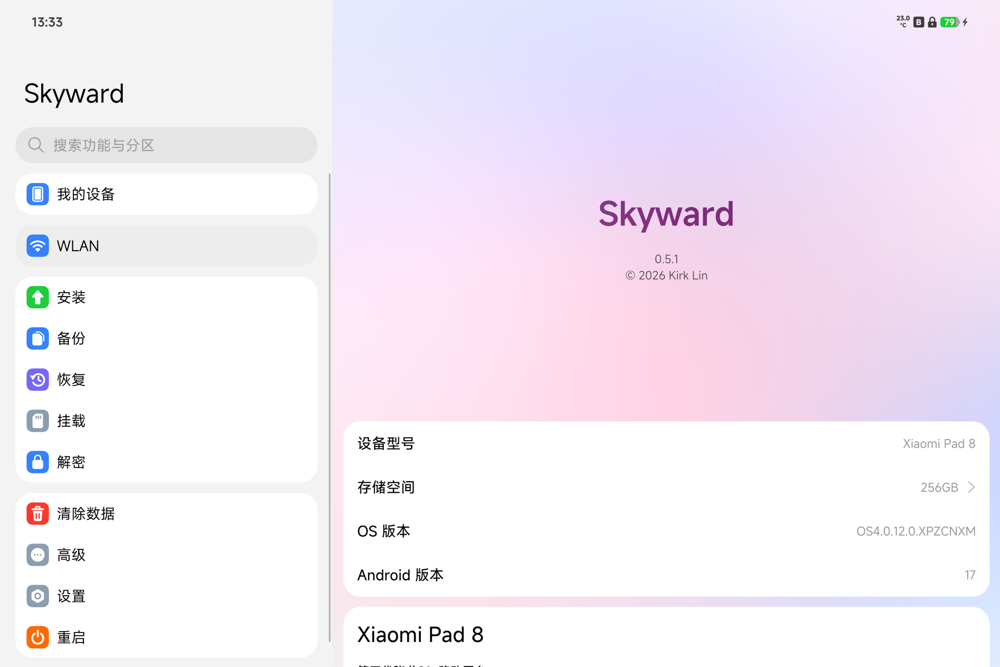
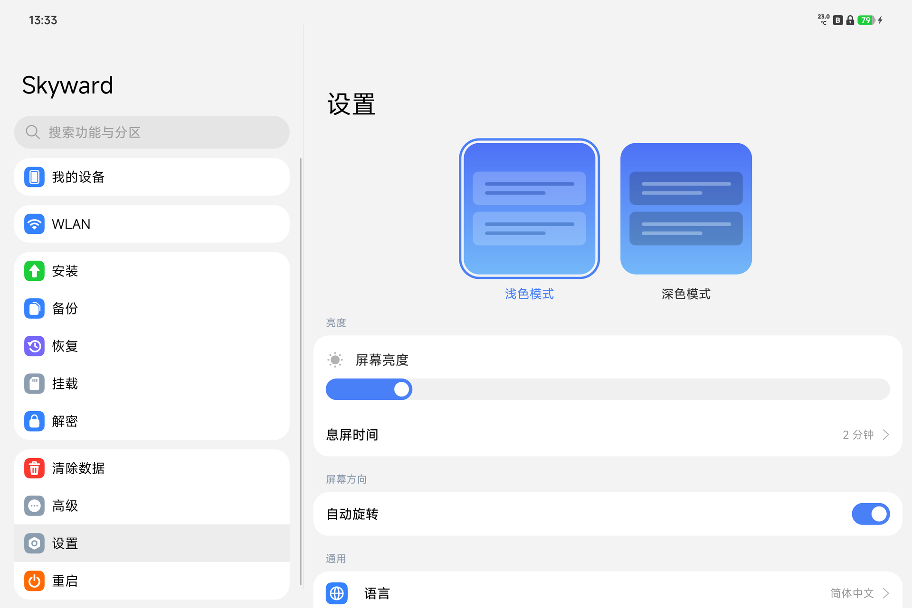

# Skyward Recovery for Xiaomi Pad 8

English · [简体中文](README.zh-CN.md)

This fork adapts Skyward, a Rust-based Android recovery by Kirklin, for **Xiaomi Pad 8 (`yupei`)**. It is based on upstream Skyward **0.5.1** and uses the stock recovery from **HyperOS OS4.0.12.0.XPZCNXM (Android 17)**.

[Pad 8 downloads](https://github.com/d2su8/skyward/releases) · [Original Skyward project](https://github.com/kirklin/skyward)

## On-device screenshots

  
  

Both images were captured in Skyward 0.5.1 on a Xiaomi Pad 8.

## Pad 8 changes

- **Display and touch.** Two-pane tablet UI for the 3200 × 2136 landscape display, Novatek NT36532 touch coordinates and reset, and display wake handling.
- **Rotation.** Qualcomm SSC over ADSP, with calibration read from `persist`, a Settings toggle, and animated orientation changes.
- **Data decryption.** Android 17 bionic runtime setup and discovery of Xiaomi’s Qualcomm QTEE Weaver alongside KeyMint and Gatekeeper.
- **Wi-Fi.** WCN7750 driver and firmware setup, reuse of the existing `persist` mount, a bounded retry for a busy driver, and handling of repeated DHCP offers.
- **Script installation.** Keep logical partition mappings used by tablet sensor services while the installer detaches the system mounts.
- **Release builds.** GitHub Actions builds `yupei` by default and publishes an image archive, SHA-256 checksums and build provenance.

The 0.5.1 sync also brings upstream’s 15-language UI, internal storage backup and restore, and expanded partition image installer. Pad 8’s tablet controls use the upstream localization system.

## Installation and updates

1. On a bootloader-unlocked **Xiaomi Pad 8 (`yupei`)**, check the installed firmware and active slot. Back up that slot’s recovery partition.
2. Download the Pad 8 ZIP and `SHA256SUMS` from this fork’s [Releases](https://github.com/d2su8/skyward/releases). Verify the ZIP and extract the `.img`.
3. In fastboot, confirm the active slot with `fastboot getvar current-slot`. Flash the image to the corresponding `recovery_a` or `recovery_b`, then run `fastboot reboot recovery`.

Download Pad 8 updates from this fork’s Releases. The built-in Skyward updater queries the upstream repository. If WLAN fails after a script ZIP detaches the system mounts, reboot Recovery before enabling WLAN again.

On 0.5.1, a local image booted on the tablet, scanned for Wi-Fi networks, and registered KeyMint, Gatekeeper and Weaver. The physical rotation and credential unlock checks below were done on the previous version.

The previous Pad 8 build was tested with credential decryption, touch, WLAN, rotation, screen wake, selected backup and restore items, and a script ZIP that only displayed test output. Full ROM and OTA installation, dual boot, and wiping remain unverified on Pad 8.

## Credits

Thanks to **Kirklin** and the [Skyward contributors](https://github.com/kirklin/skyward/graphs/contributors) for building and maintaining the [original Skyward repository](https://github.com/kirklin/skyward). Thanks to **peiyuesheng666** for the [Xiaomi Pad 6S Pro (`sheng`) port](https://github.com/peiyuesheng666/skyward), which provided the starting point for tablet layout, rotation and display wake.

See [LICENSE](LICENSE) for licensing.
