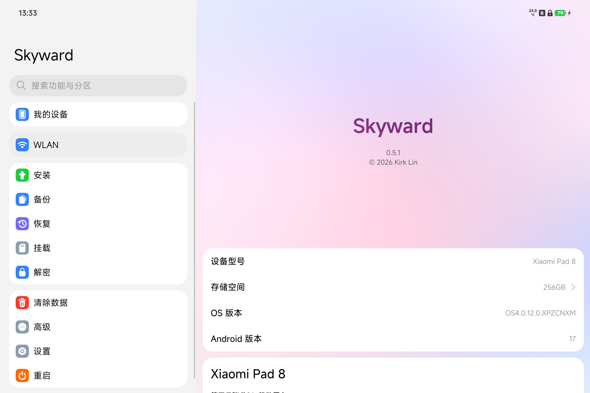
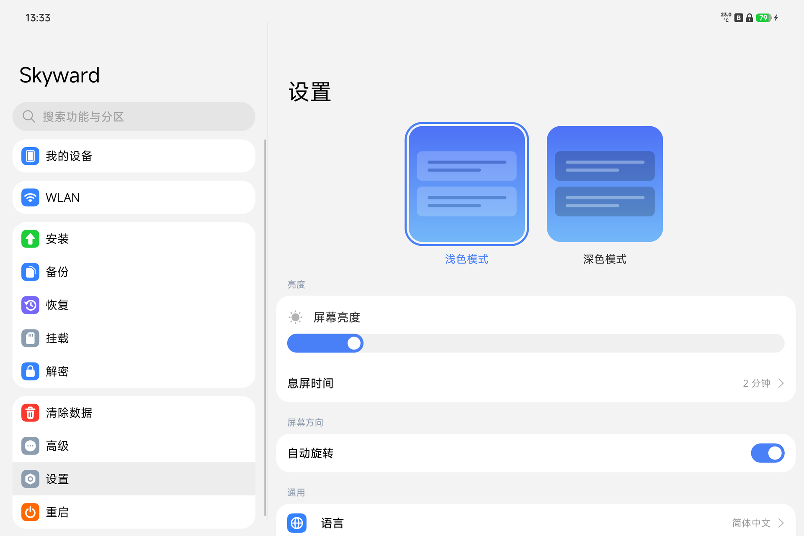

# 小米 Pad 8 专用 Skyward Recovery

[English](README.md) · 简体中文

这是专门为 **小米 Pad 8（`yupei`）** 适配的 Skyward 分支。Skyward 是 Kirklin 使用 Rust 开发的 Android Recovery。本分支已同步上游 **0.5.1**，以 **HyperOS OS4.0.12.0.XPZCNXM（Android 17）** 的原厂固件作为适配和打包基线。

[下载 Pad 8 版本](https://github.com/d2su8/skyward/releases) · [作者原仓库](https://github.com/kirklin/skyward)

## Recovery 实机截图

  
  

两张截图均来自小米 Pad 8 实机运行的 Skyward 0.5.1。

## Pad 8 做了哪些适配

- **屏幕和触摸**。针对 3200 × 2136 原生横屏提供左侧导航、右侧内容的双栏布局，适配 Novatek NT36532 触摸坐标、触摸复位及息屏唤醒。
- **自动旋转**。通过 Qualcomm ADSP 上的 SSC 读取传感器，使用 `persist` 中的校准数据，提供自动旋转开关及切换动画。
- **数据解密**。适配 Android 17 的 bionic 运行库布局，发现并启动小米的 Qualcomm QTEE Weaver、KeyMint 和 Gatekeeper 服务。
- **WLAN**。适配 WCN7750 驱动和固件，复用现有的 `persist` 挂载，处理驱动短暂繁忙及重复的 DHCP OFFER。
- **刷包兼容性**。安装脚本卸载系统分区时，保留平板传感器服务仍在使用的逻辑分区映射。
- **构建与发布**。本分支的 GitHub Actions 默认打包 `yupei`，发布镜像压缩包、SHA-256 校验清单和构建来源。

此次同步也带来了上游的 15 种界面语言、内部存储备份与恢复，以及扩展的分区镜像安装。Pad 8 的平板控件已接入上游的多语言体系。

## 安装与更新

1. 确认设备是已经解锁 Bootloader 的 **小米 Pad 8（`yupei`）**，核对系统版本及当前启动槽位，并备份该槽位的 Recovery 分区。
2. 从本仓库的 [Releases](https://github.com/d2su8/skyward/releases) 下载含 `yupei` 的 ZIP 和 `SHA256SUMS`。校验 ZIP 后解压得到 `.img`。
3. 进入 fastboot，用 `fastboot getvar current-slot` 再次核对当前槽位，将镜像刷入该槽位对应的 `recovery_a` 或 `recovery_b`，然后运行 `fastboot reboot recovery`。

Pad 8 的更新从本仓库的 Releases 下载。Recovery 内置的 Skyward 更新仍查询原作者的仓库。运行脚本 ZIP 后，如果系统挂载已卸载而 WLAN 无法启动，请重启 Recovery 再开启 WLAN。

0.5.1 的本地镜像已在实机启动，WLAN 能扫描到网络，KeyMint、Gatekeeper 和 Weaver 均已注册。实际转动与锁屏凭据解密的实测结果来自上一版。

上一版在 Pad 8 上已验证锁屏凭据解密、触摸、WLAN、自动旋转、息屏唤醒、选定项目的备份恢复，以及只显示测试输出的脚本 ZIP。完整 ROM／OTA 写入、双系统和清除数据仍未在 Pad 8 上验证。

## 上游来源与致谢

感谢 **Kirklin** 及 [Skyward 贡献者](https://github.com/kirklin/skyward/graphs/contributors) 开发和维护 [Skyward 原作者仓库](https://github.com/kirklin/skyward)。感谢 **peiyuesheng666** 的 [小米 Pad 6S Pro（`sheng`）适配](https://github.com/peiyuesheng666/skyward)，为本项目的平板布局、旋转和显示唤醒提供了基础。

许可见 [LICENSE](LICENSE)。
